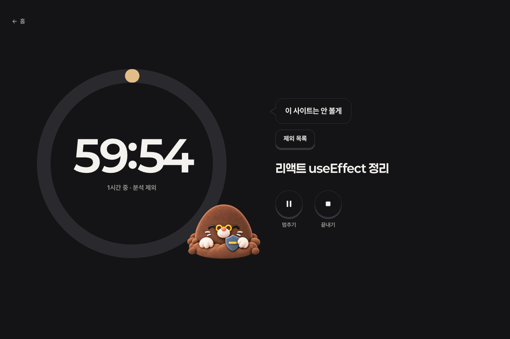

# Chrome 제외 사이트·민감 화면 Desktop 안내 결과

- 관련 [기획](chrome-guard-notice-PLAN.md) · [이슈 #398](https://github.com/What-a-move/FocusOn/issues/398)

## 구현한 부분

- 집중 화면은 사용자 제외 사이트에서 `이 사이트는 안 볼게`와 `제외 목록`을 표시한다. 민감한 화면에서는 개인정보 보호 말풍선을 사용한다. 화면 읽기 프로그램에는 유지되는 상태 영역으로 문구를 전달한다.
- Desktop은 서버가 알려준 현재 전경의 상태만 받아들인다. 등록된 전경 ID·순번이 맞지 않거나, 회차가 바뀌거나, 유효 시간이 지나면 버린다. Chrome의 상태를 확인할 수 없는 경우나 민감 판정에서는 카메라 분석을 보류한다.
- Extension은 제외 목록 검사와 서버 전경 조회를 기다리는 사이 탭이 바뀌면 이전 탭의 분석 요청을 보내지 않는다. 보호 상태를 보낼 때 제목·주소·본문을 넣지 않는다.

## 서버 연동 대기

- 현재 서버의 전경 GET에는 상태 필드가 없다. 분석 기록 GET의 `EXCLUDED`는 사용자 제외, 권한 누락, 지원 밖 페이지를 구분하지 못하고 전경 ID도 돌려주지 않는다.
- 제안 필드 `chromeGuard`는 현재 활성 회차와 연결된 Extension 탐색에 묶인 `{ status, remainingMs }` 또는 `null`이다. 탭 이동·전경 변경·연결 해제·만료로 이전 상태를 비운다. 이 상태를 Extension이 갱신하는 요청 계약은 서버와 협의한 뒤 연결한다.
- 서버 반영 전에는 현재 연결 서버에서 새 말풍선을 검증할 수 없으며 이 브랜치는 출시하지 않는다. Chrome의 확인되지 않은 상태에서는 카메라 분석이 보류된다.

## 검증

- Desktop Electron 218개, Extension 38개 테스트와 두 앱 프로덕션 빌드, 변경 파일 린트 통과.
- 빌드된 집중 화면에 모의 IPC를 연결해 제외 문구·설정 링크·민감 문구·해제, 타이머 유지를 확인했다. 실기기 서버 연동 확인은 남아 있다.

