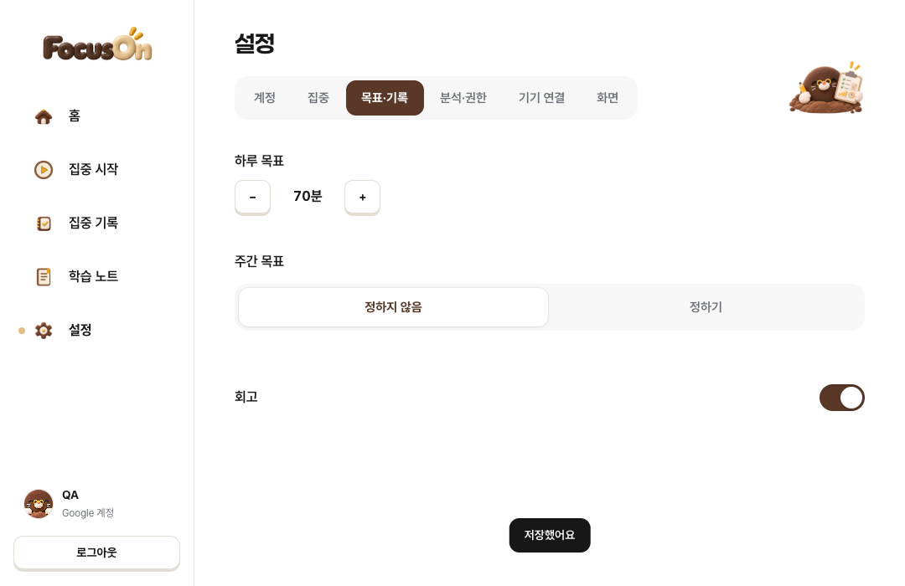
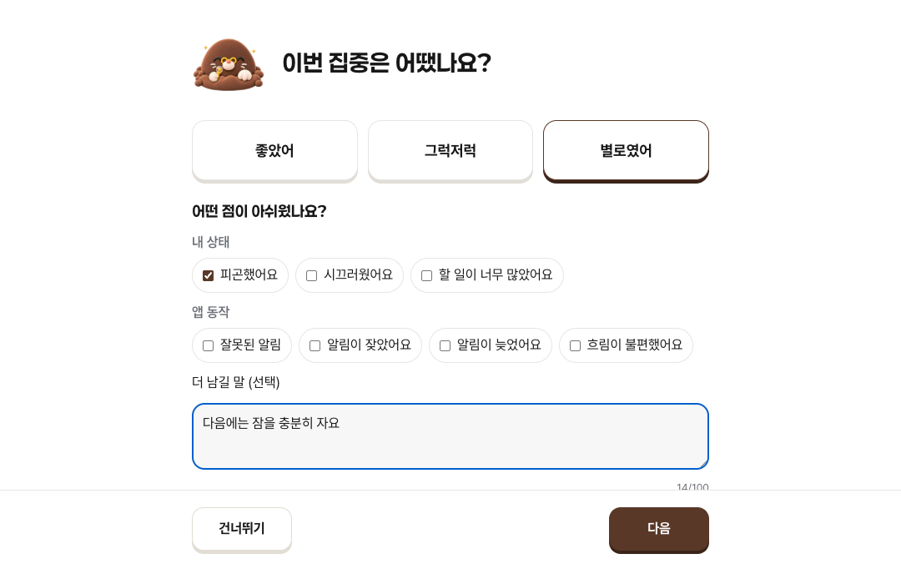

# Desktop 집중 재설계 API 연결 결과

- [기획](desktop-session-redesign-PLAN.md) · [Desktop #391](https://github.com/What-a-move/FocusOn/issues/391)
- 브랜치 `codex/391-desktop-session-redesign`

## 적용한 흐름

1. 진행 중 집중에서 할 일 3개가 찼으면 위치를 고르고 교체한다. 기존 할 일 재사용·생성 재시도와 목록 버전 충돌 처리를 유지한다.
2. 설정의 목표·기록에서 하루·주간 목표를 저장한다. 홈은 진행 요약을 표시하고 달력은 서버가 확정한 달성일에 체크를 붙인다.
3. 회고를 사용하면 종료 직후 평가·선택 사유·메모를 저장하거나 건너뛸 수 있다. 민감정보 거절 사유는 메모 원문 없이 표시한다. 동의 상세에 회고 사용 목적을 추가했다.
4. 분석·권한에서 학습용 메신저를 선택한다. 공용 화면 분석 동의 상세에 보호 규칙을 안내한다.

## 검증

- Electron 테스트 218개 통과. TypeScript Renderer·Main, Preload 및 Swift 빌드, Next.js 정적 내보내기 통과. 린트 오류 0개, 기존 경고 2개.
- 합성 IPC로 3개에서 교체, 하루 목표 변경, 주간 목표 설정·해제, 홈 진행·달력 표시, 메신저 저장·다시 열기, 실제 종료 화면에서 회고 이동, 민감 메모 거절 후 재저장, 건너뛰기와 회고 끄기를 확인했다.
- 실계정과 실제 서버로 교체·각 설정 재조회·회고 저장까지 이어지는 확인은 남아 있다.

