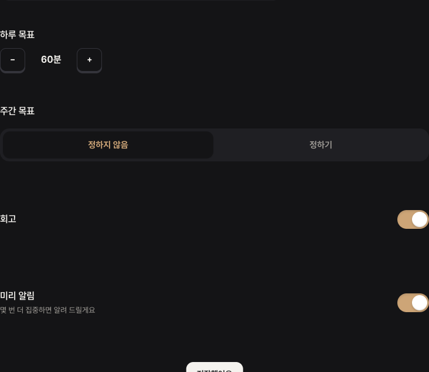

# Desktop 이탈 전 미리 알림 결과

- 관련 [기획](pre-distraction-reminder-PLAN.md) · [이슈 #395](https://github.com/What-a-move/FocusOn/issues/395)
- 선행 [리포트 #388](https://github.com/What-a-move/FocusOn/pull/388) · [목표·기록 설정 #393](https://github.com/What-a-move/FocusOn/pull/393)

## 구현 결과

- 설정 → 목표·기록의 미리 알림 스위치는 기존 설정 API로 저장한다. 조회에 성공하고 유효한 기록이 부족할 때만 부족 안내를 표시한다.
- 최근 회차 조회 결과에서 종료 회차를 최대 5개 고른다. 공통 리포트 기준의 첫 이탈까지 멈춘 시간을 빼고, 유효 3건 이상 중간값의 3분 전을 알림 시각으로 사용한다.
- 진행 중 회차의 활성 시간으로 확인하며 알림 직전에 서버 설정과 기기 알림 준비 기록을 확인한다. 멈춘 상태에서 보내지 않고 예정 시각을 15초 이상 넘기면 건너뛴다. 클릭하면 같은 활성 회차의 집중 화면을 연다.
- 재시작 중복 방지용으로 마지막 요청 회차를 구분하는 해시 하나만 기기에 둔다. 알림 본문은 정해진 문구다.

## 검증과 제한

- Electron 자동 테스트 223개, Next 프로덕션 빌드, 변경 파일 린트 통과.
- 빌드된 설정 화면을 Chrome 모의 IPC로 열어 키보드 전환, 저장 데이터, 다시 열었을 때 유지, 저장 실패 시 복구, 기록 부족 안내를 확인했다.
- 세션 1년 조회에서 최신 10건을 보고 유효한 기록이 부족하거나 필요한 요청이 실패하면 알림을 생략한다. macOS 시스템 알림과 클릭은 실계정 통합 QA에서 확인한다.

