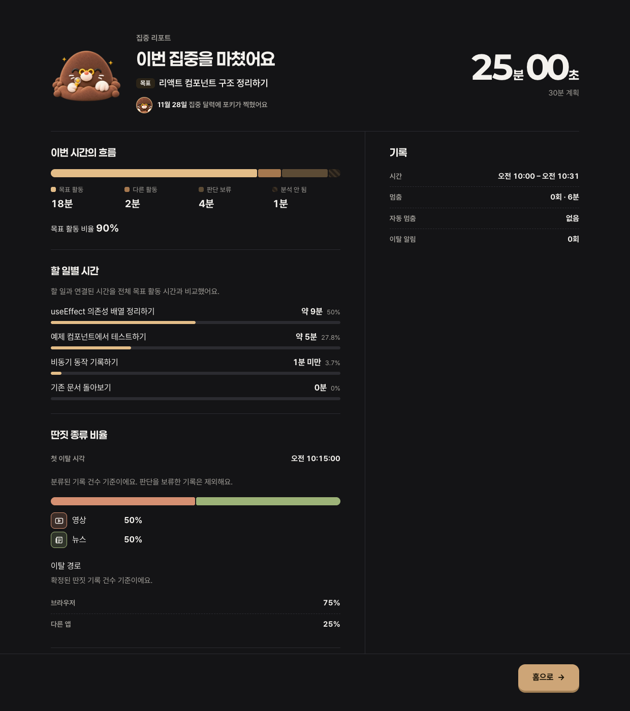

# Desktop 집중 리포트 할 일별 시간·이탈 경로 결과

- [기획](report-detail-PLAN.md) · [이슈 #400](https://github.com/What-a-move/FocusOn/issues/400) · 선행 [PR #388](https://github.com/What-a-move/FocusOn/pull/388)

## 구현

- 요약에 `goalFocusTimes`와 `relatedDurationMs`가 유효하면 할 일마다 회차에 고정한 이름, 대략적인 분, 전체 목표 활동 대비 비율을 표시한다. 0분과 1분 미만을 구분한다. 중복 ID, 빈 제목, 음수, 합계가 목표 활동 시간보다 큰 응답은 새 영역만 생략한다.
- 분석 이력의 `COMPLETED + UNRELATED`만 브라우저(`TAB_META`, `CHROME_DOM`)와 다른 앱(`APP_META`, `DESKTOP_APP_OCR`)으로 나눈다. 출처가 빠진 확정 기록이 하나라도 있으면 편향된 비율을 숨긴다. 기준은 분석 기록 건수다.
- 기존 리포트, 첫 이탈 시각, 딴짓 종류, 학습 정리, 고정 홈 버튼을 유지한다. 막대의 뜻과 값은 화면에서 숫자로도 읽을 수 있다.

## 확인

- Electron 테스트 220개, Next 프로덕션 빌드, 변경 파일 린트 통과.
- 모의 IPC로 새 집계와 기존 회차, 800×600에서 가로 넘침과 홈 버튼 위치를 확인했다.
- 현재 서버의 요약 DTO와 공개 분석 이력 DTO에 필요한 집계·출처가 없다. [기획](report-detail-PLAN.md)의 응답이 반영되면 할 일 교체 전후와 Chrome·다른 앱이 모두 기록된 회차로 QA한다.

