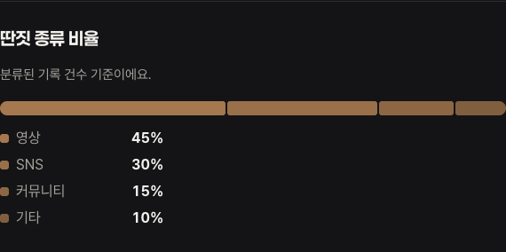

# Desktop 집중 리포트 딴짓 종류 비율 결과

- 관련 [기획](report-off-task-category-PLAN.md) · [Desktop #387](https://github.com/What-a-move/FocusOn/issues/387) · [서버 #382](https://github.com/What-a-move/FocusOn/pull/382)
- 브랜치: `codex/387-desktop-off-task-category`

## 구현 결과

- Main이 분석 이력의 `UNRELATED` 중 유효한 분류가 있는 건수로 종류별 비율을 계산한다. 이전 기록의 null과 누락을 제외하고 서버가 지정한 `OTHER`는 기타로 세며, 렌더러에는 종류와 비율만 전달한다.
- 집중 리포트에 디자인의 가로 막대와 종류·비율 목록을 넣었다. 종류 조회에 실패하면 다른 영역을 유지하고 종류 조회만 다시 시도할 수 있다.
- 온보딩·설정에서 같은 화면 분석 동의 상세를 보여 주며 저장 항목에 정책의 딴짓 종류 문구를 추가했다.

## 검증과 제한

- macOS arm64, Electron 44.1.0. Electron 테스트 217개, TypeScript, 프로덕션 빌드 통과. 린트 오류 0개(기존 온보딩 이미지 경고 2개).
- 빌드된 화면에 모의 IPC 응답을 주어 45·30·15·10% 표시, 빈 기록, 다른 영역을 유지한 채 다시 시도, 온보딩과 설정의 동의 상세를 확인했다.
- 실제 집중 세션에서 분류를 만든 뒤 동일 회차 리포트에 표시되는 흐름은 실기기 QA 대상으로 남는다.

